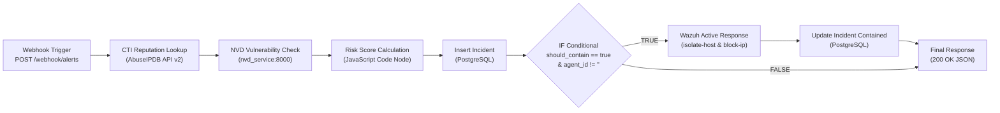

# Orquestación SOAR con n8n - Pipeline Principal de Seguridad Astrea

El componente n8n opera como el motor SOAR (Security Orchestration, Automation, and Response) central de **SecOps Astrea Platform**. Ejecutándose en el contenedor `astrea_n8n` dentro de la red Docker `astrea_network`, orquesta el flujo integral de telemetría de amenazas: ingesta de alertas desde Splunk o Wazuh, enriquecimiento con Threat Intelligence (AbuseIPDB) y base de vulnerabilidades NVD, cálculo ponderado de riesgo, persistencia transaccional en PostgreSQL y contención activa automática de endpoints vía Wazuh EDR.

---

## 1. Arquitectura del Workflow (`astrea_main_pipeline.json`)

El playbook exportable implementa un ciclo de vida defensivo automatizado con 9 nodos interconectados:



### Detalle de Nodos:
1. **Webhook Trigger (`/webhook/alerts`)**: Endpoint HTTP POST que recibe alertas con payload: `src_ip`, `dst_ip`, `agent_id`, `software_banner`, `alert_name`, `rule_id`.
2. **CTI Reputation Lookup**: Consulta la reputación de la IP atacante (`src_ip`) en AbuseIPDB con `continueOnFail` para fallback seguro si la clave API no está configurada o se alcanzan límites de tasa.
3. **NVD Vulnerability Check**: Invoca `http://nvd_service:8000/api/v1/vulnerabilities/check` enviando `software_name` y `version` extraídos del banner.
4. **Risk Score Calculation (JavaScript Code)**:
   - Aplica la fórmula ponderada:
     $$\text{RiskScore} = (\text{CTI\_Score} \times 0.4) + (\text{CVSS} \times 0.6 \times 10)$$
   - Normaliza el resultado entre $0.0$ y $100.0$.
   - Si $\text{RiskScore} \ge 80.0$, clasifica como `CRITICAL` y activa `should_contain = true`.
5. **Insert Incident PostgreSQL**: Inserta el incidente enriquecido en la tabla `security_incidents` con estado `ENRICHED`.
6. **IF Conditional**: Evalúa si `should_contain === true` y existe un `agent_id` válido.
7. **Wazuh Active Response Execution**: Invoca la API de Wazuh Manager (`POST /active-response`) para ejecutar `isolate-host` y `block-ip`.
8. **Update Incident Contained**: Actualiza el incidente a `status = 'CONTAINED_AUTOMATICALLY'`, guarda el `response_payload` y marca el agente como `isolated`.
9. **Final Response / Webhook Return**: Retorna una respuesta `200 OK` al emisor con el payload consolidado del incidente.

---

## 2. Requisitos Previos

Asegúrate de que la infraestructura Docker esté levantada y los servicios comunicados en `astrea_network`:

```bash
docker-compose up -d
```

Verifica el estado de los contenedores:
```bash
docker ps --filter "name=astrea"
```

Deben estar en ejecución:
- `astrea_postgres` (Puerto 5432)
- `astrea_n8n` (Puerto 5678)
- `astrea_nvd_service` (Puerto 8000)
- `astrea_dashboard_bid` (Puerto 8501)

---

## 3. Guía de Despliegue y Configuración Paso a Paso

### Paso 1: Acceder a la Interfaz Web de n8n
1. Abre tu navegador web e ingresa a:
   ```
   http://localhost:5678
   ```
2. Si es la primera vez que inicias n8n, completa el formulario inicial para configurar la cuenta del administrador local (nombre, email y contraseña).

### Paso 2: Importar el Playbook `astrea_main_pipeline.json`
1. En el menú lateral izquierdo de n8n, dirígete a **Workflows**.
2. Haz clic en el botón superior derecho de opciones (**...**) o en **Add workflow**.
3. Selecciona la opción **Import from File**.
4. Navega en tu sistema de archivos y selecciona:
   ```
   orchestration/n8n/workflows/astrea_main_pipeline.json
   ```
5. El flujo completo se cargará en el lienzo visual mostrando todos los nodos y sus conexiones configuradas.

### Paso 3: Configurar las Credenciales de PostgreSQL
Para que los nodos de base de datos puedan persistir los incidentes en PostgreSQL, configura la credencial en n8n:

1. En el menú lateral izquierdo, haz clic en **Credentials**.
2. Haz clic en **Add Credential** y busca **PostgreSQL**.
3. Configura los siguientes parámetros (alineados con `.env.example` y `docker-compose.yml`):
   - **Credential Name**: `Astrea PostgreSQL`
   - **Host**: `postgres` *(nombre DNS del contenedor dentro de `astrea_network`)*
   - **Database**: `secops_astrea_db`
   - **User**: `secops_user`
   - **Password**: `secops_secure_password`
   - **Port**: `5432`
   - **SSL**: `disable`
4. Haz clic en **Test Connection** para certificar la conectividad con la base de datos y luego en **Save**.
5. Regresa al workflow importado y verifica que los nodos **Insert Incident PostgreSQL** y **Update Incident Contained** tengan asignada la credencial recién creada.

> [!NOTE]
> **Variables de entorno opcionales**:
> Si dispones de API keys para AbuseIPDB o Wazuh Manager, puedes configurarlas en tu archivo `.env` en la raíz del proyecto (`ABUSEIPDB_API_KEY`, `WAZUH_API_HOST`, `WAZUH_API_USER`, `WAZUH_API_PASSWORD`). El workflow cuenta con mecanismos de fallback seguro en caso de que alguna API externa no esté disponible.

### Paso 4: Activar el Workflow
1. En la barra superior derecha del editor de n8n, localiza el interruptor de estado.
2. Cambia el estado de **Inactive** a **Active**.
3. Haz clic en el botón **Save** (o `Ctrl + S`).
4. El webhook quedará expuesto y listo para recibir telemetría en:
   ```
   http://localhost:5678/webhook/alerts
   ```

---

## 4. Pruebas de Integración con `curl`

### Prueba 1: Alerta Crítica con Contención Activa Automática
Simula una alerta de severidad alta con explotación conocida (`Apache/2.4.49` - CVE-2021-41773 con CVSS 9.8) que sobrepasa el umbral de contención ($\ge 80.0$):

```bash
curl -X POST http://localhost:5678/webhook/alerts \
  -H "Content-Type: application/json" \
  -d '{
    "alert_name": "Apache Path Traversal RCE Attempt",
    "rule_id": "100020",
    "src_ip": "185.220.101.5",
    "dst_ip": "10.0.0.15",
    "dst_port": 80,
    "agent_id": "001",
    "software_banner": "Apache/2.4.49"
  }'
```

**Respuesta esperada (HTTP 200 OK)**:
```json
{
  "status": "success",
  "message": "Incident processed and orchestrated successfully by Astrea SOAR",
  "incident_id": "9b1deb4d-3b7d-4bad-9bdd-2b0d7b3dcb6d",
  "incident_status": "CONTAINED_AUTOMATICALLY",
  "alert_name": "Apache Path Traversal RCE Attempt",
  "rule_id": "100020",
  "agent_id": "001",
  "src_ip": "185.220.101.5",
  "dst_ip": "10.0.0.15",
  "calculated_risk_score": 90.8,
  "severity": "CRITICAL",
  "contained": true,
  "active_response_executed": "isolate-host, block-ip",
  "timestamp": "2026-10-15T12:00:00.000Z"
}
```

### Prueba 2: Alerta de Riesgo Bajo/Medio (Sin Aislamiento)
Simula una alerta con software actualizado y baja reputación de amenaza que no supera el umbral de contención ($< 80.0$):

```bash
curl -X POST http://localhost:5678/webhook/alerts \
  -H "Content-Type: application/json" \
  -d '{
    "alert_name": "Informational Reconnaissance Activity",
    "rule_id": "100001",
    "src_ip": "192.168.1.50",
    "dst_ip": "10.0.0.15",
    "dst_port": 443,
    "agent_id": "001",
    "software_banner": "Nginx/1.24.0"
  }'
```

**Respuesta esperada (HTTP 200 OK)**:
```json
{
  "status": "success",
  "message": "Incident processed and orchestrated successfully by Astrea SOAR",
  "incident_id": "c4a9235e-63de-48fb-a9e2-892415174092",
  "incident_status": "ENRICHED",
  "alert_name": "Informational Reconnaissance Activity",
  "rule_id": "100001",
  "agent_id": "001",
  "src_ip": "192.168.1.50",
  "dst_ip": "10.0.0.15",
  "calculated_risk_score": 15.0,
  "severity": "LOW",
  "contained": false,
  "active_response_executed": "NONE",
  "timestamp": "2026-10-15T12:00:00.000Z"
}
```

---

## 5. Verificación de Persistencia en PostgreSQL

Puedes verificar que los incidentes y acciones de respuesta activa quedaron registrados en PostgreSQL ejecutando:

```bash
docker exec -it astrea_postgres psql -U secops_user -d secops_astrea_db -c \
  "SELECT incident_id, alert_name, src_ip, calculated_risk_score, status, active_response_executed FROM security_incidents ORDER BY detected_at DESC LIMIT 5;"
```

Para auditar el estado del endpoint en el inventario:
```bash
docker exec -it astrea_postgres psql -U secops_user -d secops_astrea_db -c \
  "SELECT agent_id, hostname, ip_address, status FROM agents_inventory;"
```

---

## 6. Ejecución de Pruebas Automatizadas

El esquema y lógica del workflow son validados de manera determinista mediante pytest:

```bash
python -m pytest tests/test_n8n_workflow_schema.py -v
```

La suite valida:
- Sintaxis JSON y estructura nativa de n8n v1.x+.
- Configuración del Webhook Trigger (`POST /webhook/alerts`).
- Fórmula ponderada en JavaScript: `RiskScore = (CTI_Score * 0.4) + (CVSS * 0.6 * 10)`.
- Normalización en rango $0.0$ a $100.0$ y corte en $80.0$ para contención.
- Integridad topológica de conexiones sin nodos huérfanos.
